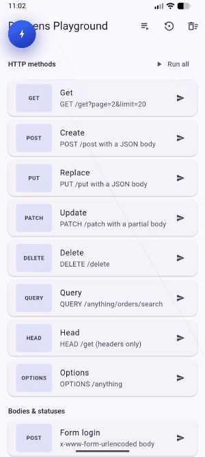
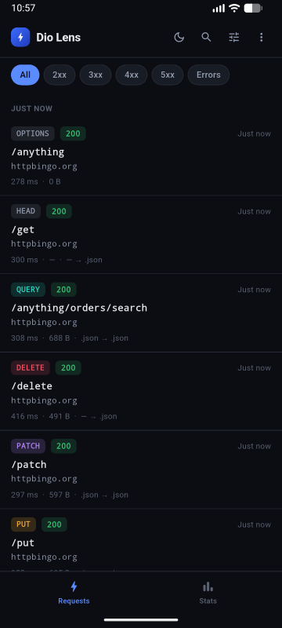
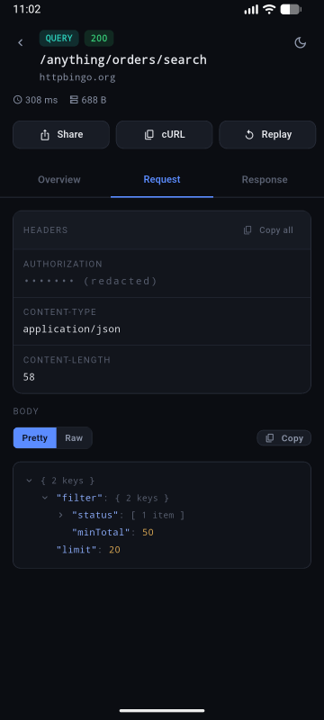
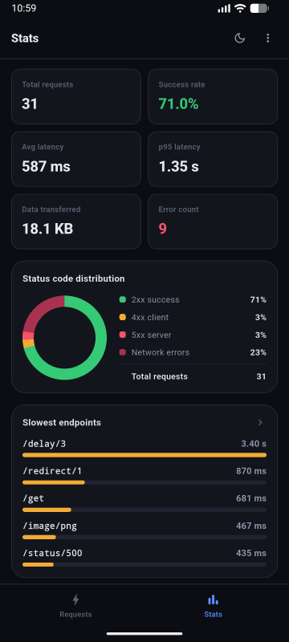
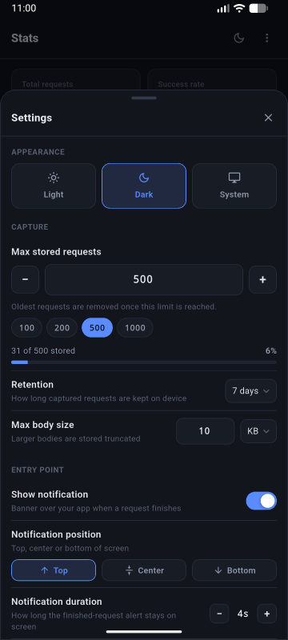
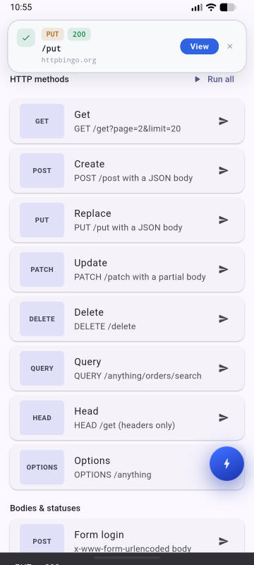
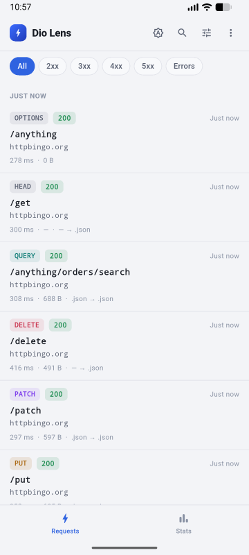

# Dio Lens

An in-app network inspector for [Dio](https://pub.dev/packages/dio). See every
request your app makes, from inside the app: headers, bodies, timing, errors
and stats. Replay requests, export them as HAR or JSON, and share them, with
sensitive values masked.

<p align="center">
  
</p>

## Screenshots

|                               Requests                                |                                                        Request detail                                                         |                                            Stats                                             |
| :-------------------------------------------------------------------: | :---------------------------------------------------------------------------------------------------------------------------: | :------------------------------------------------------------------------------------------: |
|    |  |                                     |
|                             **Settings**                              |                                                  **Request-finished banner**                                                  |                                       **Light theme**                                        |
|  |                                                  |  |

## Features

- **Request list** with search, method and status filters, grouping by time,
  Share, cURL and Replay
  buttons on each row, swipe to delete and pull to refresh.
- **Request detail** with Overview, Request and Response tabs: collapsible
  JSON tree, raw view, form and text bodies, image previews, error details
  with stack trace, copyable fields and a cURL command.
- **Stats**: totals, success rate, average and p95 latency, status
  distribution, and the slowest, largest and most-called endpoints and top
  hosts.
- **Replay** a request through your own Dio, so your interceptors (auth,
  refresh) apply.
- **Export** every request as HAR 1.2 or JSON, and **share** one as a
  readable text report.
- **Redaction** of sensitive headers and query parameters in the UI,
  exports, shares and console logs, each switchable.
- **Floating bubble** to open Dio Lens, and a **banner** when a request
  finishes.
- **Console logging** of requests, responses and errors, in a readable
  format, configurable per interceptor.
- **Settings sheet** for limits, retention, body size, notifications,
  the bubble, redaction and theme. Settings persist.
- **Light, dark and system themes**, applied to Dio Lens only, never to your
  app. Right-to-left layouts supported.
- **Lightweight**: capture never blocks requests, body processing and JSON
  work run in background isolates, and only request summaries are kept in
  memory.

## Getting started

Add the package:

```sh
flutter pub add dio_lens
```

Set it up before `runApp`, give the same navigator key to your
`MaterialApp`, and add the interceptor to your Dio:

```dart
import 'package:dio/dio.dart';
import 'package:dio_lens/dio_lens.dart';
import 'package:flutter/material.dart';

final navigatorKey = GlobalKey<NavigatorState>();
final dio = Dio();

void main() {
  DioLens.init(navigatorKey: navigatorKey);

  // Add Dio Lens last, so it records what earlier interceptors added.
  dio.interceptors.add(DioLensInterceptor(dio: dio));

  runApp(MaterialApp(navigatorKey: navigatorKey, home: const HomePage()));
}
```

That's it. Requests made through `dio` appear in Dio Lens. Open it with the
floating bubble, the **View** button of the request-finished banner, or from
code:

```dart
DioLens.open();
```

See the [example](example/lib/main.dart) for a complete app.

## Console logging

`DioLensInterceptor` also prints each request, response and error to the
console in a pretty, indented format, with `[REQUEST]`, `[RESPONSE]` or
`[ERROR]` in each header. It's meant for developers, alongside `flutter logs`
or your IDE's console, and is set up in code, never from the settings sheet.

Logs print in the build modes passed as `consoleMode` to `DioLens.init` (debug
only by default; see [Build modes](#build-modes)). Choose what they show with
`consoleSettings`:

```dart
dio.interceptors.add(
  DioLensInterceptor(
    dio: dio,
    consoleSettings: const DioLensConsoleSettings(
      responseBody: false,
      maxWidth: 120,
    ),
  ),
);
```

| Setting             | Default | Description                                                    |
| ------------------- | ------- | -------------------------------------------------------------- |
| `request`           | `true`  | Print the request method and URL.                              |
| `requestHeader`     | `true`  | Print query parameters, request headers, options and extras.   |
| `requestBody`       | `true`  | Print the request body.                                        |
| `responseHeader`    | `true`  | Print response headers.                                        |
| `responseBody`      | `true`  | Print the response body.                                       |
| `error`             | `true`  | Print errors.                                                  |
| `compact`           | `true`  | Print short maps and lists on one line.                        |
| `maxWidth`          | `90`    | Line width before wrapping.                                    |
| `showStateInHeader` | `true`  | Prefix section headers with `[REQUEST]`, `[RESPONSE]` or `[ERROR]`. |

Console logs mask sensitive values as the `redactionMode` setting says (see
[Settings](#settings)). To send logs somewhere else, pass `logPrint`; it
defaults to `dart:developer`'s `log` with the name `dio_lens`.

## Build modes

Dio Lens shows captured headers and bodies, tokens included, so by default it
only runs in debug builds. Two modes, passed to `DioLens.init`, decide where it
runs:

- `uiMode`: recording requests and the UI (bubble, banner, pages, settings).
  Turn it on for profile builds to let testers inspect traffic during UAT.
- `consoleMode`: console logs, for developers.

```dart
DioLens.init(
  navigatorKey: navigatorKey,
  uiMode: DioLensMode.debugProfile,
  consoleMode: DioLensMode.debug,
);
```

| Mode              | Debug | Profile | Release |
| ----------------- | :---: | :-----: | :-----: |
| `none`            |       |         |         |
| `debug` (default) |   ✓   |         |         |
| `profile`         |       |    ✓    |         |
| `release`         |       |         |    ✓    |
| `debugProfile`    |   ✓   |    ✓    |         |
| `debugRelease`    |   ✓   |         |    ✓    |
| `profileRelease`  |       |    ✓    |    ✓    |
| `all`             |   ✓   |    ✓    |    ✓    |

Outside both modes the interceptor does nothing.

## Settings

Pass starting settings to `DioLens.init`. Users can change them in the
settings sheet, and the stored values then take precedence.

```dart
DioLens.init(
  navigatorKey: navigatorKey,
  settings: const DioLensSettings(
    maxRequests: 200,
    retention: DioLensRetention.sevenDays,
    maxBodyBytes: 512 * 1024,
    notificationPosition: DioLensNotificationPosition.bottom,
  ),
);
```

| Setting                | Default                                              | Description                                                                           |
| ---------------------- | ---------------------------------------------------- | ------------------------------------------------------------------------------------- |
| `maxRequests`          | `500`                                                | Most requests kept (10 to 10,000); the oldest are removed.                            |
| `retention`            | `oneDay`                                             | How long requests are kept: `session`, `oneHour`, `oneDay`, `sevenDays` or `always`.  |
| `maxBodyBytes`         | 1 MB                                                 | Largest body kept; bigger bodies are stored truncated. `null` keeps every body whole. |
| `showNotification`     | `true`                                               | Show a banner when a request finishes.                                                |
| `notificationPosition` | `top`                                                | Banner position: `top`, `center` or `bottom`.                                         |
| `notificationDuration` | 4 s                                                  | How long the banner stays (2 to 15 seconds).                                          |
| `showBubble`           | `true`                                               | Show the floating bubble.                                                             |
| `bubblePosition`       | `bottomEnd`                                          | Corner the bubble starts in; follows the reading direction.                           |
| `redactionMode`        | `redact`                                             | Where listed headers and query parameters are masked; see [Redaction](#redaction). |
| `redactedHeaders`      | `authorization`, `cookie`, `set-cookie`, `x-api-key` | Header names to mask, case-insensitive.                                               |
| `redactedQueryParams`  | `token`, `apikey`, `password`                        | Query parameter names to mask, case-insensitive.                                      |
| `themeMode`            | `dark`                                               | Dio Lens theme: light, dark or system.                                                |

Read and change settings from code:

```dart
final current = DioLens.settings.value;
await DioLens.updateSettings(current.copyWith(showBubble: false));
await DioLens.resetSettings(); // Back to the values passed to init.
```

## Redaction

Values of the headers and query parameters in `redactedHeaders` and
`redactedQueryParams` are masked in three places, chosen with
`redactionMode`:

- **UI**: the request list, the Request and Response tabs, the header of the
  detail page, exports and shared reports.
- **Clipboard**: the Overview tab and every cURL command (the cURL buttons and
  the cURL section of shared reports).
- **Console**: console logs.

| `redactionMode`    | UI  | Clipboard | Console |
| ------------------ | :-: | :-------: | :-----: |
| `redact` (default) |  ✓  |     ✓     |    ✓    |
| `ui`               |  ✓  |           |         |
| `clipboard`        |     |     ✓     |         |
| `console`          |     |           |    ✓    |
| `uiClipboard`      |  ✓  |     ✓     |         |
| `uiConsole`        |  ✓  |           |    ✓    |
| `clipboardConsole` |     |     ✓     |    ✓    |
| `off`              |     |           |         |

Testers can change it in the settings sheet's Privacy section.

## Export and share

Dio Lens builds export files and share reports in memory and hands them to
your app. It never saves anything itself, so you decide whether to save,
share or upload.

```dart
DioLens.init(
  navigatorKey: navigatorKey,
  onExport: (DioLensExportFile file) async {
    // file.fileName, file.bytes, file.mimeType, file.requestCount
  },
  onShare: (DioLensShareContent content) async {
    // content.subject, content.text
  },
);
```

- Without `onExport`, the export buttons are disabled. You can also build an
  export from code with `DioLens.export(DioLensExportFormat.har)`.
- Without `onShare`, sharing copies the report to the clipboard.

Exports and shares mask values as the redaction settings say.

## Replay

Replay sends a request again from its detail page. Pass your Dio to the
interceptor so the replay goes through it, with your interceptors, base
options and adapter:

```dart
dio.interceptors.add(DioLensInterceptor(dio: dio));
```

If your app has several Dio instances with the same base URL, give each a
`name` so requests from earlier app runs replay through the right one:

```dart
uploadDio.interceptors.add(DioLensInterceptor(dio: uploadDio, name: 'upload'));
```

- Requests from the current run are re-sent exactly as originally sent,
  file uploads included.
- Requests from earlier runs are rebuilt from what was captured. Ones whose
  file uploads or bodies weren't fully captured can't be replayed, and Dio
  Lens says so instead of sending something different.
- Without a Dio, replays go through a plain Dio, and Dio Lens prints a
  one-time hint in the console.

## Custom storage

Requests and settings persist with `shared_preferences` by default. To use
your own database or format, extend `DioLensStorage` and pass it to
`DioLens.init`.

- Records are plain JSON-encodable maps, so storage needs no Dio Lens types.
- Each request has a full record and a small summary used for lists. Store
  them separately so startup reads only summaries. If your storage can't,
  return the full records from `readSummaries`; they work as summaries too.
- Dio Lens applies the request limit and retention itself, and never calls
  two storage methods at once.

Here is a complete storage that keeps one JSON file per summary and per
request, using only `dart:io`:

````dart
import 'dart:convert';
import 'dart:io';

import 'package:dio_lens/dio_lens.dart';

/// A [DioLensStorage] that keeps each request as two JSON files, a small
/// summary and the full record, plus one file for the settings:
///
/// ```text
/// <directory>/summaries/<id>.json
/// <directory>/requests/<id>.json
/// <directory>/settings.json
/// ```
class FileDioLensStorage extends DioLensStorage {
  /// Creates a storage that writes under [directory].
  FileDioLensStorage(this.directory);

  /// Folder holding every file this storage writes.
  final Directory directory;

  Directory get _summaries => Directory('${directory.path}/summaries');
  Directory get _requests => Directory('${directory.path}/requests');
  File get _settings => File('${directory.path}/settings.json');

  File _summaryFile(String id) => File('${_summaries.path}/$id.json');
  File _requestFile(String id) => File('${_requests.path}/$id.json');

  @override
  Future<List<Map<String, dynamic>>> readSummaries() => _readAll(_summaries);

  @override
  Future<Map<String, dynamic>?> readRequest(String id) =>
      _read(_requestFile(id));

  @override
  Future<List<Map<String, dynamic>>> readRequests() => _readAll(_requests);

  @override
  Future<void> writeRequest(
    String id, {
    required Map<String, dynamic> request,
    required Map<String, dynamic> summary,
  }) async {
    await _write(_requestFile(id), request);
    await _write(_summaryFile(id), summary);
  }

  @override
  Future<void> deleteRequests(List<String> ids) async {
    for (final id in ids) {
      await _delete(_requestFile(id));
      await _delete(_summaryFile(id));
    }
  }

  @override
  Future<void> clearRequests() async {
    for (final folder in [_requests, _summaries]) {
      if (await folder.exists()) await folder.delete(recursive: true);
    }
  }

  @override
  Future<Map<String, dynamic>?> readSettings() => _read(_settings);

  @override
  Future<void> writeSettings(Map<String, dynamic> json) =>
      _write(_settings, json);

  @override
  Future<void> clearSettings() => _delete(_settings);

  /// The JSON object in [file]; null when it is missing or unreadable.
  Future<Map<String, dynamic>?> _read(File file) async {
    if (!await file.exists()) return null;
    try {
      final json = jsonDecode(await file.readAsString());
      return json is Map<String, dynamic> ? json : null;
    } on FormatException {
      return null;
    }
  }

  /// Every readable JSON object in [folder], in any order.
  Future<List<Map<String, dynamic>>> _readAll(Directory folder) async {
    if (!await folder.exists()) return [];
    final rows = <Map<String, dynamic>>[];
    await for (final entity in folder.list()) {
      if (entity is! File || !entity.path.endsWith('.json')) continue;
      if (await _read(entity) case final json?) rows.add(json);
    }
    return rows;
  }

  /// Writes [json] to a temporary file, then renames it into place, so a
  /// crash never leaves a half-written file.
  Future<void> _write(File file, Map<String, dynamic> json) async {
    await file.parent.create(recursive: true);
    final temp = File('${file.path}.tmp');
    await temp.writeAsString(jsonEncode(json), flush: true);
    await temp.rename(file.path);
  }

  Future<void> _delete(File file) async {
    if (await file.exists()) await file.delete();
  }
}
````

Use it with any folder. For example, with
[path_provider](https://pub.dev/packages/path_provider) in your app:

```dart
import 'dart:io';

import 'package:dio_lens/dio_lens.dart';
import 'package:flutter/material.dart';
import 'package:path_provider/path_provider.dart';

Future<void> main() async {
  WidgetsFlutterBinding.ensureInitialized();
  final support = await getApplicationSupportDirectory();

  DioLens.init(
    navigatorKey: navigatorKey,
    storage: FileDioLensStorage(Directory('${support.path}/dio_lens')),
  );

  runApp(const MyApp());
}
```

## API

| Member                                       | Description                                                                 |
| -------------------------------------------- | --------------------------------------------------------------------------- |
| `DioLens.init(...)`                          | Sets Dio Lens up. Call once, before the first request.                      |
| `DioLens.open()`                             | Opens the Dio Lens home.                                                    |
| `DioLens.openRequest(id)`                    | Opens the detail page of one request.                                       |
| `DioLens.settings`                           | Current settings, as a `ValueListenable`.                                   |
| `DioLens.updateSettings(settings)`           | Applies and stores settings.                                                |
| `DioLens.resetSettings()`                    | Goes back to the settings passed to `init`.                                 |
| `DioLens.export(format)`                     | Builds an export of every request.                                          |
| `DioLens.clear()`                            | Removes every captured request.                                             |
| `DioLens.isInitialized` | Whether `init` was called. |
| `DioLens.isUiEnabled`, `DioLens.isConsoleEnabled` | Whether recording and the UI, and console logs, are on in this build. |

## Platform support

Android, iOS, macOS, Windows and Linux. Web isn't supported, because Dio Lens
processes request bodies in background isolates.

## License

See [LICENSE](LICENSE).
